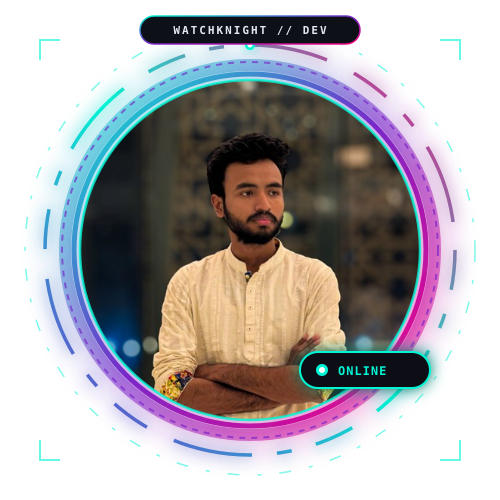

<div align="center">

<!-- ==================== HERO HEADER ==================== -->


<br/>

<!-- ==================== ANIMATED CYBER AVATAR ==================== -->
<a href="https://github.com/watchknight">
  
</a>

<br/><br/>

<!-- Dynamic Animated Typing Subtitle -->
<a href="https://github.com/watchknight">
  
</a>

<br/>

<!-- Real-time Status Badges & Bulletproof Visitor Counter -->
<p align="center">
  
  
  
  
</p>

<!-- Quick Navigation Bar -->
<p align="center">
  <a href="#-about-me"><b>About Me</b></a> •
  <a href="#-featured-innovations"><b>Featured Projects</b></a> •
  <a href="#-tech-arsenal"><b>Tech Arsenal</b></a> •
  <a href="#-github-telemetry"><b>GitHub Stats</b></a> •
  <a href="#-contribution-snake-arena"><b>Snake Arena</b></a> •
  <a href="#-connect--collaborate"><b>Connect</b></a>
</p>

---

</div>

<br/>

## 👨‍💻 About Me

<table>
  <tr>
    <td width="60%" valign="top">
      <h3>Hey there, traveler of the web! 👋</h3>
      <p>
        I'm <b>Abdur Rahman Moayed</b> (widely known across cyberspace as <b>WatchKnight</b>). I am a passionate software craftsman and creative engineer based in <b>Dhaka, Bangladesh 🇧🇩</b>.
      </p>
      <p>
        My work sits at the intersection of <b>mindful computing</b>, <b>ambient digital canvases</b>, and <b>scalable web architecture</b>. I believe software should not simply accomplish a task—it should feel intuitive, fluid, and delightful to experience.
      </p>
      <ul>
        <li>🧠 <b>Currently Building:</b> Interactive zero-gravity canvases, cognitive focus guardians, and document intelligence tools.</li>
        <li>🔬 <b>Engineering Philosophy:</b> <i>"Simplicity before complexity. Elegance before optimization."</i></li>
        <li>🌱 <b>Exploring:</b> Advanced 2D/3D physics engines on the web, distributed event-driven systems, and ambient user interfaces.</li>
        <li>⚡ <b>Beyond Code:</b> Deep-work advocate, typography enthusiast, and lifelong explorer of creative mediums.</li>
      </ul>
    </td>
    <td width="40%" valign="top">

```typescript
// 🔴 🟡 🟢 abdur_rahman.ts

const engineer: Developer = {
  name: "Abdur Rahman Moayed",
  handle: "watchknight",
  locale: "Dhaka, Bangladesh 🇧🇩",
  mindset: "Builder & Lifelong Learner",
  passions: [
    "Ambient Interfaces",
    "Zero-Gravity Web Canvases",
    "Deep Focus Tools",
    "TypeScript & Scalable UX"
  ],
  fuel: ["Quality Coffee ☕", "Curiosity 🚀"]
};

export default engineer;
```

   </td>
  </tr>
</table>

<br/>

---

## 🌟 Featured Innovations & Creations

<p align="center"><i>A curated selection of real-world open-source applications built with precision and care.</i></p>

<table>
  <tr>
    <td width="50%" valign="top">
      <h3>🧠 <a href="https://github.com/watchknight/Mental-Defrag">Mental-Defrag</a></h3>
      <p>An ambient, zero-gravity physics canvas and thought-processing sandbox for brainstorming, cognitive unloading, and mental defragmentation.</p>
      <p>
        
        
        
      </p>
      <p><a href="https://github.com/watchknight/Mental-Defrag"><b>Explore Repository →</b></a></p>
    </td>
    <td width="50%" valign="top">
      <h3>🛡️ <a href="https://github.com/watchknight/FocusGuard">FocusGuard</a> & <a href="https://github.com/watchknight/FocusLab">FocusLab</a></h3>
      <p>A cognitive productivity ecosystem designed to shield focus, eliminate digital distractions, and induce sustained creative flow.</p>
      <p>
        
        
        
      </p>
      <p><a href="https://github.com/watchknight/FocusLab"><b>Explore Repository →</b></a></p>
    </td>
  </tr>
  <tr>
    <td width="50%" valign="top">
      <h3>🔍 <a href="https://github.com/watchknight/DocLensBD">DocLensBD</a></h3>
      <p>High-precision document inspection, extraction, and verification platform engineered for clarity and rapid data comprehension.</p>
      <p>
        
        
        
      </p>
      <p><a href="https://github.com/watchknight/DocLensBD"><b>Explore Repository →</b></a></p>
    </td>
    <td width="50%" valign="top">
      <h3>🌿 <a href="https://github.com/watchknight/TrashTrail">TrashTrail</a></h3>
      <p>Smart civic waste management and ecological impact tracker connecting environmental accountability with intuitive community tools.</p>
      <p>
        
        
        
      </p>
      <p><a href="https://github.com/watchknight/TrashTrail"><b>Explore Repository →</b></a></p>
    </td>
  </tr>
  <tr>
    <td width="50%" valign="top">
      <h3>🍲 <a href="https://github.com/watchknight/Rannabanna">Rannabanna</a></h3>
      <p>A contemporary culinary and gastronomy web platform celebrating authentic culinary arts with rich search and dynamic recipe guides.</p>
      <p>
        
        
        
      </p>
      <p><a href="https://github.com/watchknight/Rannabanna"><b>Explore Repository →</b></a></p>
    </td>
    <td width="50%" valign="top">
      <h3>⚡ <a href="https://github.com/watchknight/PureFeed">PureFeed</a> & <a href="https://github.com/watchknight/BitForge">BitForge</a></h3>
      <p>Distraction-free information feed engine alongside modular developer tooling utilities for clean code craftsmanship.</p>
      <p>
        
        
        
      </p>
      <p><a href="https://github.com/watchknight/PureFeed"><b>Explore Repositories →</b></a></p>
    </td>
  </tr>
</table>

<br/>

---

## 🛠️ Tech Arsenal & Mastered Stacks

<div align="center">

### 💻 Core Languages
<p align="center">
  <a href="https://skillicons.dev">
    
  </a>
</p>

### 🌐 Frontend & Ambient UI Engine
<p align="center">
  <a href="https://skillicons.dev">
    
  </a>
</p>

### ⚙️ Backend, Architecture & Cloud
<p align="center">
  <a href="https://skillicons.dev">
    
  </a>
</p>

### 🗄️ Databases, Environments & Tooling
<p align="center">
  <a href="https://skillicons.dev">
    
  </a>
</p>

</div>

<br/>

---

## 🐍 Contribution Snake Arena

<div align="center">

<p>
  <b>🎮 Arcade Mission:</b> Keep the snake fed with fresh commits! Every contribution on GitHub fuels the snake's journey across the matrix.
</p>

<picture>
  <source media="(prefers-color-scheme: dark)" srcset="https://raw.githubusercontent.com/watchknight/watchknight/output/github-contribution-grid-snake-dark.svg">
  <source media="(prefers-color-scheme: light)" srcset="https://raw.githubusercontent.com/watchknight/watchknight/output/github-contribution-grid-snake.svg">
  
</picture>

<p align="center">
  <sub>⚡ Automated via GitHub Actions: runs daily at 00:00 UTC to reflect my latest commits!</sub>
</p>

</div>

<br/>

---

## 📊 GitHub Telemetry & Milestones

<div align="center">

<!-- Developer Badges & Milestones -->
<p align="center">
  
  
  
  
</p>

<br/>

<!-- Stats Grid using Reliable & High-Performance Endpoints -->
<table>
  <tr>
    <td width="50%" align="center">
      
    </td>
    <td width="50%" align="center">
      
    </td>
  </tr>
  <tr>
    <td colspan="2" align="center">
      
    </td>
  </tr>
</table>

</div>

<br/>

---

## 🎧 Coding Atmosphere & Philosophy

<div align="center">

<!-- Ambient Lofi & Philosophy Card -->
<table>
  <tr>
    <td align="center" style="background-color: #0d1117; padding: 20px; border-radius: 14px; border: 1px solid #30363d;">
      <p style="font-size: 15px; margin-bottom: 8px;">
        <b>🎵 CURRENT VIBE:</b> <i>Deep Flow • Ambient Lo-Fi Beats & Synthesizers</i> ☕ 🎧
      </p>
      <code>[ ■■■■■■■■■■■■□□□□□□□□ 60% — Compiling Mindful Solutions ]</code>
      <br/><br/>
      <p style="font-size: 14px; color: #00f5d4; font-family: monospace; margin: 12px 0;">
        "There are only two hard things in Computer Science: cache invalidation, naming things, and off-by-one errors."
      </p>
      <p style="font-size: 13px; color: #94a3b8;">
        <i>"Code is like humor. When you have to explain it, it’s bad."</i> — Cory House
      </p>
    </td>
  </tr>
</table>

</div>

<br/>

---

## 🤝 Connect & Collaborate

<div align="center">

<p>
  Whether you have an exciting project, want to discuss ambient canvases, or simply want to say hello — my inbox and socials are always open!
</p>

<p align="center">
  <a href="https://linkedin.com/in/watchknight" target="_blank">
    
  </a>
  <a href="https://github.com/watchknight" target="_blank">
    
  </a>
  <a href="mailto:watchknight@users.noreply.github.com">
    
  </a>
  <a href="https://twitter.com/watchknight" target="_blank">
    
  </a>
  <a href="https://discord.com/users/watchknight" target="_blank">
    
  </a>
</p>

<br/>

<p align="center">
  <a href="https://github.com/watchknight?tab=repositories">
    
  </a>
  &nbsp;
  <a href="https://github.com/watchknight/watchknight/issues/new?title=Hello%20Moayed!&body=Let's%20collaborate%20on%20something%20awesome!">
    
  </a>
</p>

<br/>

<!-- Footer Gradient Wave -->


<p align="center">
  <b>Designed with passion & precision by Abdur Rahman Moayed (watchknight) ✨</b>
  <br/>
  <sub>⭐️ If you like any of my projects, don't forget to star them!</sub>
</p>

</div>
